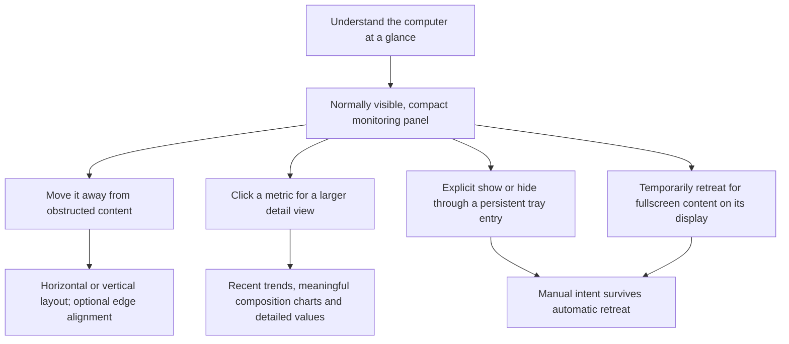
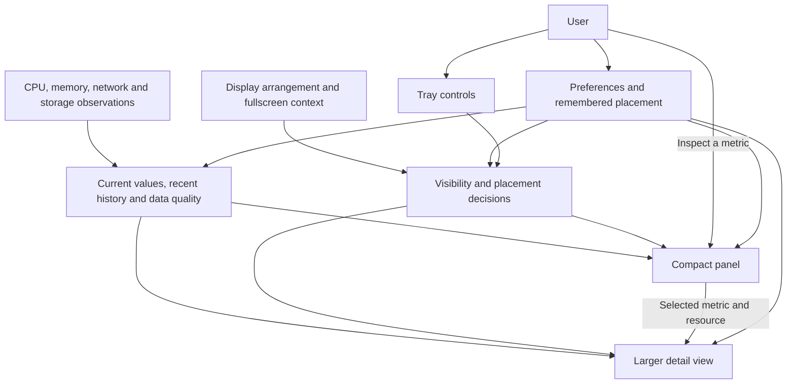
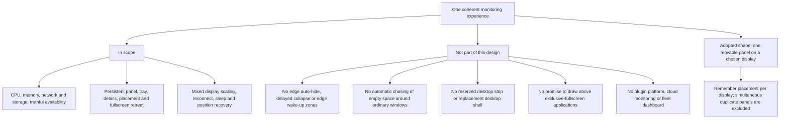

# 00 — Product and Architecture

[Catalog](README.md) · [Next: user surfaces](01-user-surfaces.md)

## Product Intent

MyFinder provides two levels of attention: a compact surface for continuous awareness and a larger detail view for intentional inspection. It is not a desktop shell, a docking framework, or a miniature dashboard that must always display every available measurement. Moving the panel solves a placement problem; it does not introduce additional visibility modes.

The monitoring experience should remain useful without administrator privileges. Optional unavailable measurements must not prevent CPU, memory, network or storage information from being shown. The product does not promise that a floating window can avoid covering every application control; the user can move, hide or lock it.

## Conceptual Responsibilities

The adopted architecture is one desktop application in the user's session, using the repository's existing C# / WinUI 3 / .NET foundation. There is no requirement for a service, an elevated companion process, an embedded web application, or a plugin host. This is a technical direction, not a claim that the current foundation already owns the following behavior.

| Responsibility | Owns | Does not own |
| --- | --- | --- |
| Observation and recent history | Resource identity, measurement meaning, quality, current values and bounded history | Window placement or chart interaction |
| Desktop context | Display arrangement, scaling, usable bounds and fullscreen observations | The user's visibility preference |
| Presentation decisions | Effective visibility, reachable placement and coordinated surface lifetimes | Sampling or interpretation of measurements |
| User surfaces | Glance, inspection, tray controls and settings interaction | Independent copies of monitoring history or competing visibility policies |
| Preferences | Remembered user choices | Temporary fullscreen state, focus or live readings |

These are ownership boundaries, not a prescribed set of projects, classes or services. Observation work should not block interaction, and opening a detail view must not start a second independent monitoring session. Both summary and detail read the same observations.

## Technical Choices and Tradeoffs

- **One source of presentation decisions.** Tray actions, fullscreen changes and display recovery are inputs to the same decision. Letting each window decide independently would make hide/show ordering difficult to reason about.
- **One compact panel plus one contextual detail view is the adopted initial scope.** It supports occasional deep inspection without turning the desktop into a collection of independent chart windows. Settings are a separate explicit interaction, not another monitoring dashboard.
- **A floating surface, not a reserved desktop strip.** This preserves ordinary application layout, at the cost of possible overlap. Dragging and manual hiding are the remedies; automatic wandering around other windows is excluded.
- **Local, bounded recent observations.** History is session-local and bounded to at most one hour, not a durable monitoring database. Cross-restart observations are excluded; only user preferences persist.
- **Built-in monitoring domains.** Adding a new metric should extend the common observation and presentation concepts, not require a general-purpose plugin system.

## Scope Boundaries

The behavior below defines the product boundary. One panel is the adopted scope; simultaneous panels on multiple displays are excluded from the initial product. Multi-display correctness remains required. Exact defaults and acceptance gates are fixed in [the adopted baseline](08-design-baseline.md).

