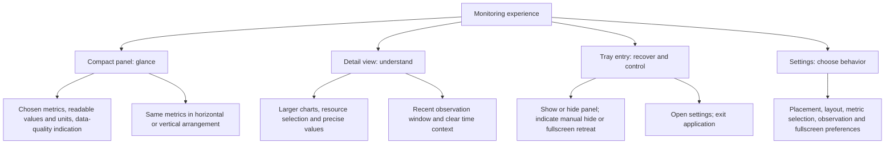
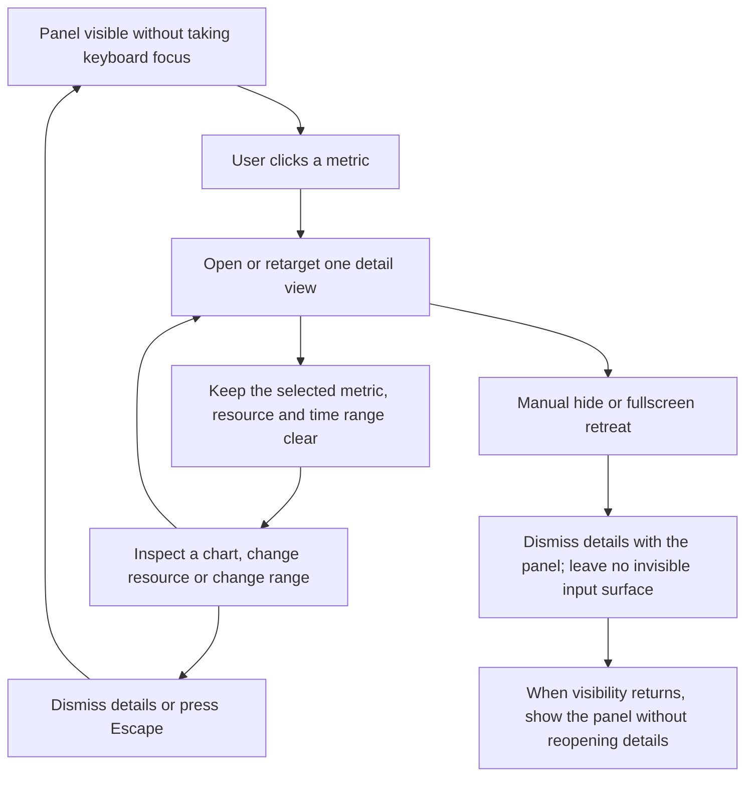
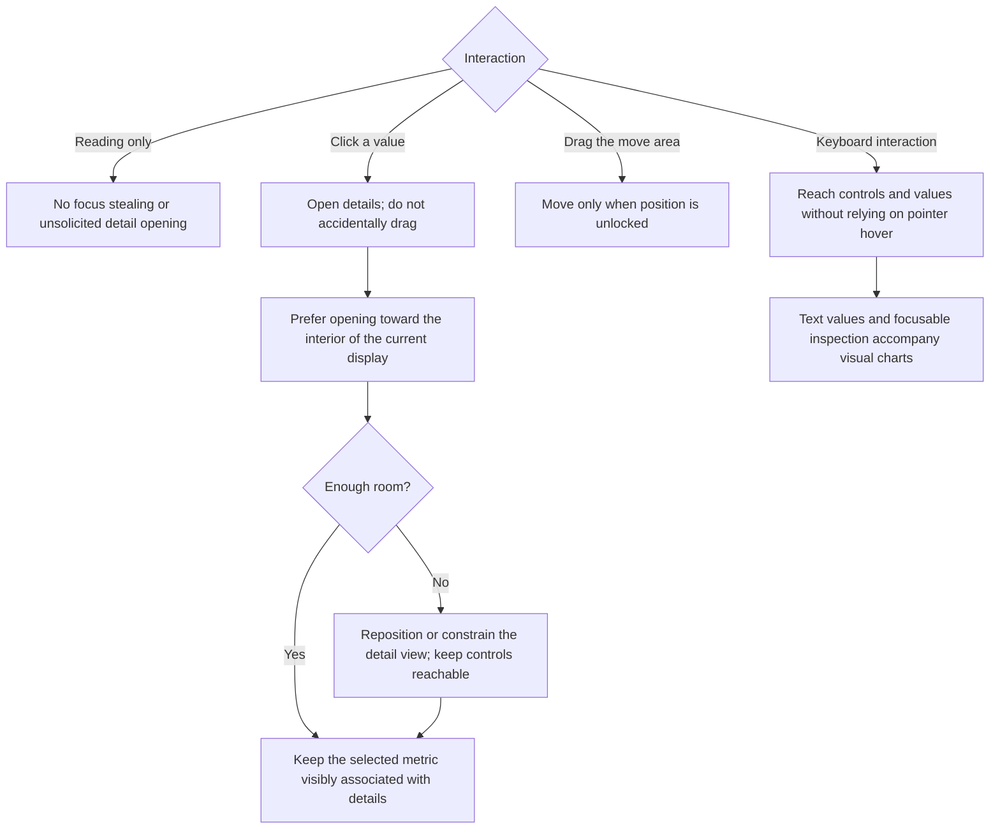

# 01 — User Surfaces

[Catalog](README.md) · [Next: visibility](02-visibility.md)

## Surface Responsibilities

The compact panel answers **what is happening now**. The detail view answers **what changed recently and what does this resource contain**. The tray is the persistent control path when the panel is not visible; hiding is not quitting.

The adopted surface arrangement is a compact, non-disruptive panel, one larger contextual detail view, and an explicitly opened settings view. The tray belongs to the application rather than to the lifetime of a visible panel. Closing details or settings must not terminate monitoring. Ordinary readings do not take keyboard focus; an explicit inspection can accept keyboard interaction.

Horizontal and vertical layouts use the same metric selection and order. Their information hierarchy is shared, but their spacing and arrangement are designed for their shape. Neither is a rotated screenshot of the other.

## Footprint, Style and Density

Orientation, visual style and size are independent choices. The three supported styles are **Balanced**, **Minimal** and **Capsules**; they are not three different monitoring systems, nor six mandatory modes when combined with orientation. Horizontal and vertical presentations share the same selected metrics. A monitored drive does not automatically add another permanent tile.

The panel has an adjustable size with a minimum usable layout. Reduce optional sparklines and spacing before sacrificing readable values, units, resource identity or interaction targets. Do not uniformly shrink text and controls to satisfy an arbitrary rectangle. Text scaling can increase the minimum. If the user's selected content cannot fit, explain the constraint or allow an explicit content choice; do not rotate metrics automatically or hide essential units.

**Adopted base sizes:** Minimal is 432 × 32, Balanced 528 × 48 and Capsules 528 × 40 logical pixels in the four-metric horizontal layout. Vertical equivalents, 100%–200% sizing, content-driven minimums and text-scale rules are defined in [the sizing contract](08-design-baseline.md#sizing-contract). These targets require native validation; they are not measurements. Board 13 distinguishes desktop illustration scale from its 1:1 component drawing.

Details have their own size and information budget. The wide layout uses a resource rail, chart area and fact groups; a narrow layout replaces the rail with a resource chooser and moves secondary facts below the chart. Keep the heading, close action, range and current quality reachable. Scroll detail content rather than shrinking all typography or enlarging the persistent panel. Resizing or switching resources must not reset collection or history.

## Glance to Inspection

A click carries the selected metric and resource into the detail view. Reuse that view when another metric is selected, rather than accumulate independent windows. The view offers a larger trend chart, relevant composition charts, precise values, resource selection and a recent-time selector; it need not show every chart type for every metric.

**Dismissal policy:** Escape, explicit close, or clicking outside dismisses details; leaving the panel with the pointer does not. Opening settings also dismisses the transient details. Manual hide and fullscreen retreat dismiss details as part of the same interaction boundary. When the compact panel returns, details stay closed until requested again. A pin-to-desktop detail mode is excluded from the initial scope.

## Focus, Input and Placement

Dragging should begin from a recognizable move area so that a click intended to inspect a value does not move the panel. Position lock disables accidental movement, not the ability to open settings or details. Keyboard operation must offer the same meaningful data as pointer inspection; essential meaning must not depend on color alone.

The detail view is associated with the compact panel's current display. It prefers available space toward the interior, but may reposition or constrain its content to stay usable. This association is a logical ownership rule, not a decision about specific window APIs. Application-driven recovery must not activate an unrelated window or steal focus.

