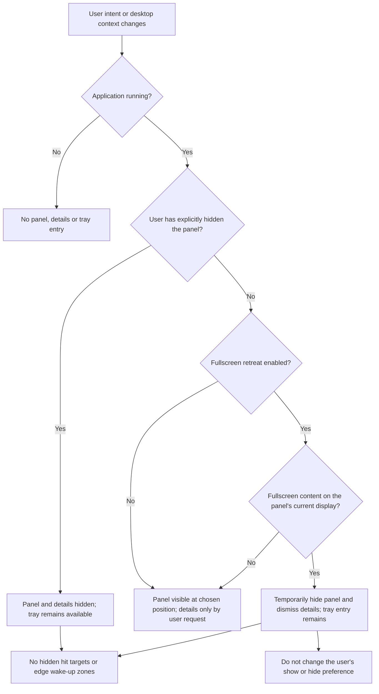
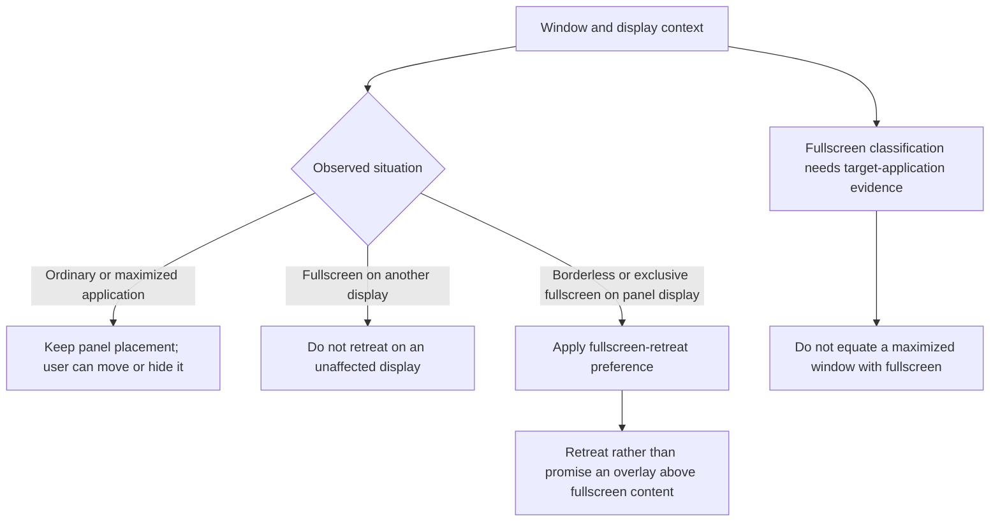
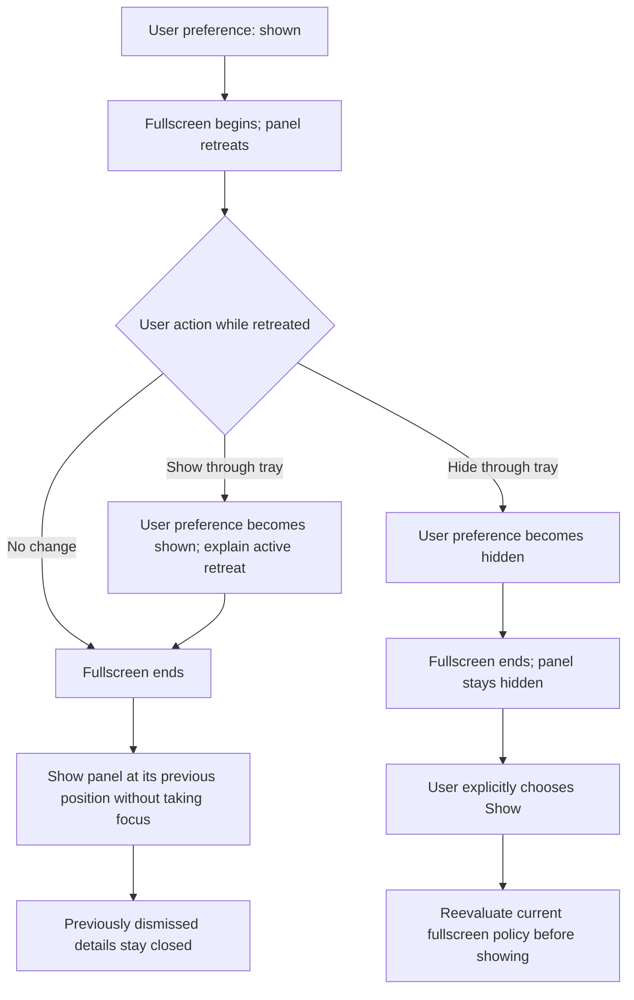

# 02 — Visibility and Fullscreen Retreat

[Catalog](README.md) · [Next: placement and displays](03-placement-and-displays.md)

## Visibility Decision

Visibility has two independent inputs: **persistent user intent** and **temporary desktop context**. The user's intent is shown or hidden. Fullscreen retreat is a temporary reason not to present an otherwise shown panel; it never rewrites that intent. This distinction is the central state-management decision.

One presentation policy derives the result after any relevant change. Manual hiding always wins. With retreat enabled, fullscreen on the current display temporarily suppresses the panel and its details. A tray Show action during fullscreen changes intent to shown but does not bypass the active retreat policy; the tray should explain why the panel is still absent. The user can explicitly change the fullscreen preference if different behavior is wanted.

This is not a collection of independent hide/show commands whose ordering happens to produce the right result. Reevaluate the latest intent and context together so that fullscreen exit, display changes or late notifications cannot reshow a manually hidden panel.

## Fullscreen Is Not Ordinary Obstruction

Fullscreen classification uses relevant application state, visible display coverage and display association together. A single maximized flag or size comparison is not an adequate product definition. Ordinary maximized windows remain ordinary windows even when they occupy most of a monitor.

Desktop-context changes should prompt reevaluation; window movement and activation transitions should settle without visible hide/show oscillation. A small amount of internal transition stabilization may be necessary, but it is not the removed user-facing delayed-collapse feature. The implementation must meet the 500 ms settled-context response and no-oscillation acceptance target in chapter 08. Internal scheduling is not a user-facing timer or an open product decision.

The [adopted acceptance matrix](08-design-baseline.md#compatibility-and-evidence-gates) names Edge, VLC, LibreOffice Impress, SuperTuxKart and a controlled exclusive-fullscreen test application, including fullscreen on a non-panel display. This document does not claim a universal fullscreen detector. Disabling retreat means keeping ordinary floating-window behavior, not a guarantee of appearing above exclusive-fullscreen content.

## Intent Survives Temporary Retreat

Restoring visibility must preserve position and avoid focus changes. Transient detail views are dismissed, not silently reopened. Settings explicitly opened from the tray are user-requested interaction and are not an automatically displayed monitoring overlay; opening them must not force the panel visible. Exit is the separate action that ends observation and removes the tray entry.

