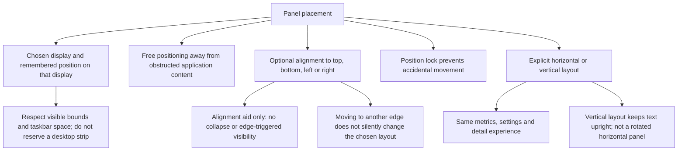
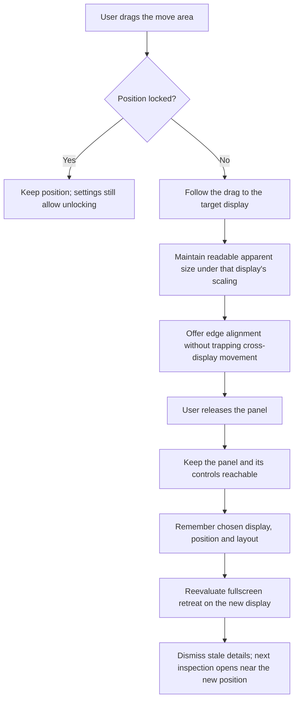
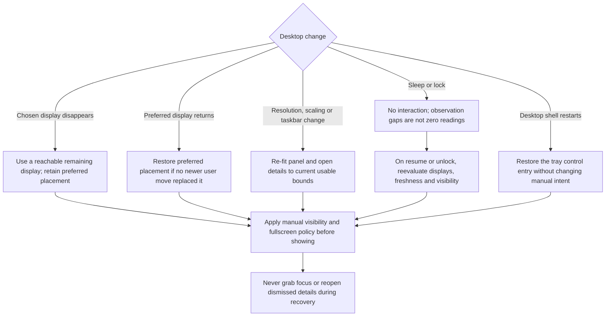

# 03 — Placement and Displays

[Catalog](README.md) · [Next: observations and history](04-observations-and-history.md)

## Placement Choices

Placement is a user choice, not an automatic search for empty space. The panel can be placed freely or aligned to any of the four edges, with an optional lock after positioning. Alignment does not reserve desktop space, hide the panel, or create a pointer activation zone. The user chooses horizontal or vertical layout explicitly; moving to another edge should not silently change that choice.

**Position model:** remember the chosen display, alignment where used, and position relative to that display's usable area. An aligned position should preserve its relationship to the selected edge; a free position should remain proportionally recognizable when usable bounds change. Readable dimensions are distinct from physical pixel coordinates. This avoids treating a mixed-scaling desktop as one flat coordinate space while leaving exact coordinate mechanics to detailed design.

## Fitting Without Becoming a Dock

Panel size is a logical-size preference subject to readable content and current text scaling, not a request to occupy a percentage of the desktop. The minimum varies with orientation, style and enabled content. Increasing the monitored resource set must not change this footprint. A smaller window removes optional decoration before essential labels; it never introduces edge collapse.

The detail surface may resize independently. On constrained usable bounds, switch to a resource chooser and a vertically scrollable fact area. Keep the close action and essential navigation reachable; move or constrain the window before clipping content behind the taskbar. The adopted base sizes and minimum-content rules are in [chapter 08](08-design-baseline.md#sizing-contract). Native fit and high-text-scale behavior remain validation work, not conclusions from static boards.

## Moving Between Displays

The current display becomes the owner of scaling, placement constraints and fullscreen retreat. Crossing a monitor boundary must not create a second observation session or change which resource a metric represents. Position lock affects dragging only; explicit placement changes through settings remain possible.

The panel and details must remain within usable bounds, with the taskbar and its activation area respected. Neighboring display edges should assist alignment without preventing pointer travel. On a completed move, dismiss the old detail placement rather than leave a detached detail window on the previous screen.

## Display and Session Changes

Preferred placement and temporary fallback placement are different facts. If the preferred display disappears, select a reachable remaining display but retain the preference. A new explicit user move replaces that preference; otherwise, reconnecting the preferred display may restore it. Every recovery passes through the visibility policy before showing anything.

The same reconciliation covers resolution changes, scaling changes, taskbar changes and resume. Recover only what is needed: reachable surfaces, correct visibility and a usable tray control path. Do not restore old keyboard focus or reopen a dismissed detail view. The exact display matching behavior must be validated against hot-plug and reordered displays; remembering an enumeration position alone is not the design contract.

