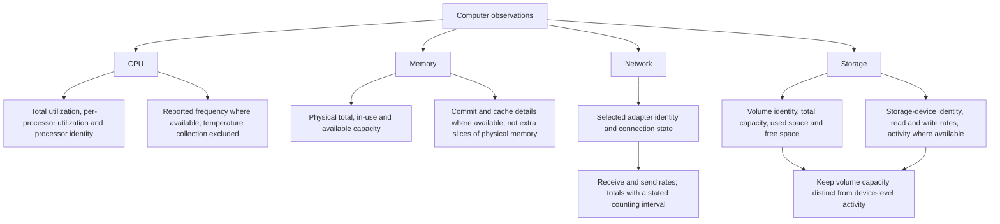
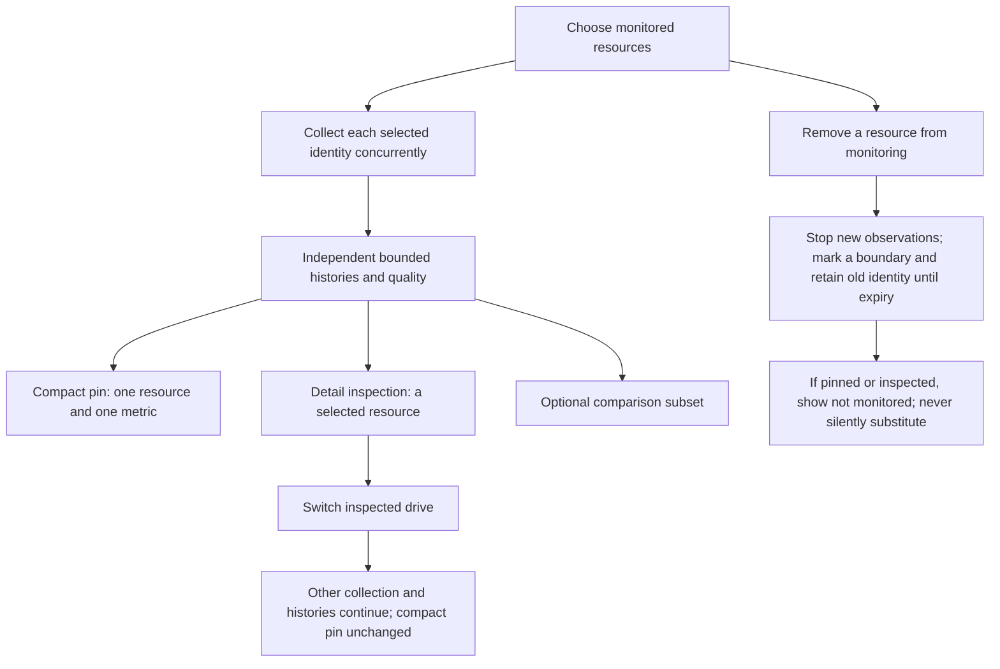
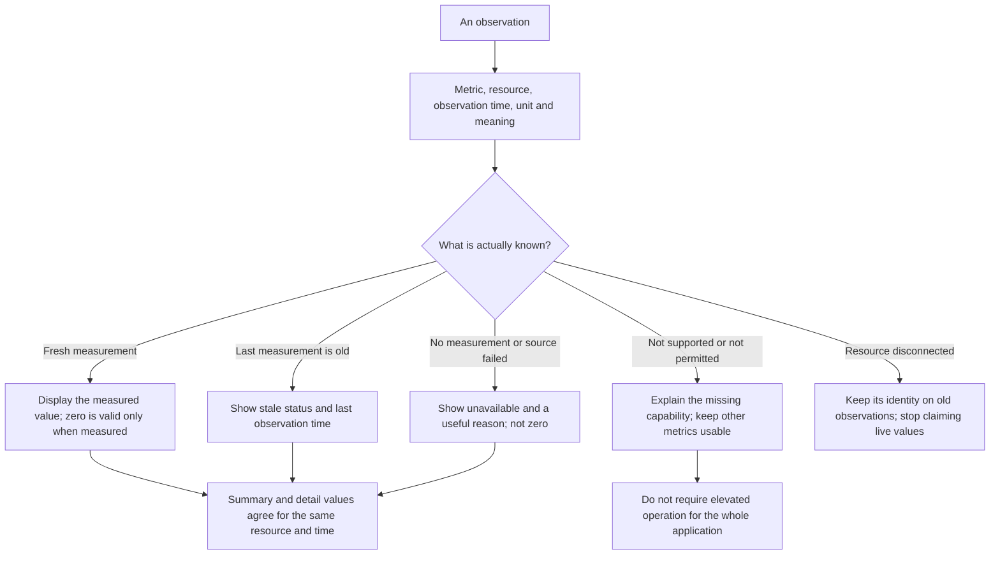
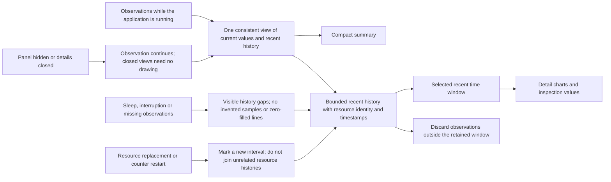

# 04 — Observations and Recent History

[Catalog](README.md) · [Next: charts and details](05-charts-and-details.md)

## Observation Domains

The design separates **resource facts** from **measurements over time**. A processor name or volume identity describes the selected resource; utilization and throughput describe its behavior. Capacity is a time-varying gauge, not throughput. Each displayed value must retain that distinction.

CPU, memory, network and storage are built-in domains sharing observation semantics. Domain-specific collection interprets the available operating-system information; the presentation layer should not reconstruct rates or guess resource relationships. Frequency and activity details remain explicitly unavailable when unsupported; hardware-sensor collection is excluded from the initial scope. A chart cannot turn an unsupported measurement into a completed feature.

Network views should select named adapters explicitly. The initial design does not silently sum physical, virtual and tunnel adapters into a machine-wide total. Storage views distinguish volume capacity from physical-device activity and only expose a relationship when known.

## Monitor, Display and Inspect Are Separate Choices

Several drives can be monitored concurrently. The **monitored set** determines collection; the **compact selection** determines which resource and metric occupy a fixed panel slot; the **inspection selection** determines the open detail view. A comparison selection contains a small, explicitly chosen subset of monitored resources. Changing inspection or comparison never stops collection for the others, resets their histories, changes the compact pin or grows the panel.

The default storage presentation pins one volume and one capacity metric to the compact storage slot. Other choices such as a named device's activity are explicit alternatives, not rotating readings. Clicking the slot opens that resource; subsequent navigation inside details remains independent. The overview lists all monitored resources, including unavailable ones, with their own quality and last-observed time.

Adding a resource starts its own coverage interval; earlier history is unavailable. Removing it from monitoring stops future collection but preserves identified existing observations until normal expiration. If it is pinned or inspected, keep that identity with a stopped-monitoring explanation and an explicit replacement action. Do not silently repin. Re-enabling the same confirmed identity preserves a visible collection gap. A reused drive letter or display name is not sufficient evidence of identity.

Volume capacity and device activity can coexist, but they must retain separate scopes. Do not count both a device and its child volumes as independent throughput contributors, add device-busy percentages, or sum physical and virtual adapters without a defined non-overlapping scope. The starting design prefers per-resource rows and shared-scale small multiples over an ambiguous total. Any future aggregate must state the included set and identify partial coverage.

## Observation Meaning and Quality

Every observation is understood in terms of a metric, resource, observation time, unit and quality. This is a semantic contract, not a proposed record schema. Unavailable, stale, unsupported and disconnected are not alternate spellings of zero. The detail view should explain the distinction without interrupting unrelated monitoring.

Rates derived from changing counters must use the actual elapsed observation interval. The first reading establishes context rather than inventing a rate; a reset or resource replacement starts a new interval instead of producing a negative rate or a spike. Totals must identify their counting interval, such as this application session, rather than imply lifetime totals.

Current values, chart points and time-window summaries are views of the same observations. Freshness is measured against actual collection behavior, not merely the fact that the UI recently redrew. Missing data should be local to the affected metric or resource rather than blanking the entire application.

## Recent History Lifecycle

Recent history is shared, bounded and kept in memory for the current application session. Dynamic activity benefits from a more responsive cadence than slow-changing capacity and hardware facts. Retention balances useful recent context against memory cost; shortened coverage is explicit when limits require expiration. Sampling cadence, retention and display refresh remain distinct choices rather than one global speed control.

Observation is independent of drawing. Hiding the panel or closing details keeps collecting recent history while the application is running, so the next inspection has context. Sleeping or unavailable sources create real gaps; resuming does not backfill measurements that were never made. Exit stops collection. Cross-restart observation retention is excluded initially, avoiding a database and disk-write policy until a durable-history need is confirmed.

History remains bounded by time and a bounded set of selected resources. When a resource disappears, its existing observations retain their identity until expiration; a similarly named replacement must not inherit them. Larger observation sets and chart windows should reduce display work, not multiply collectors. Resource discovery, sampling, history limits and display refresh are related budgets but are not the same operation.

