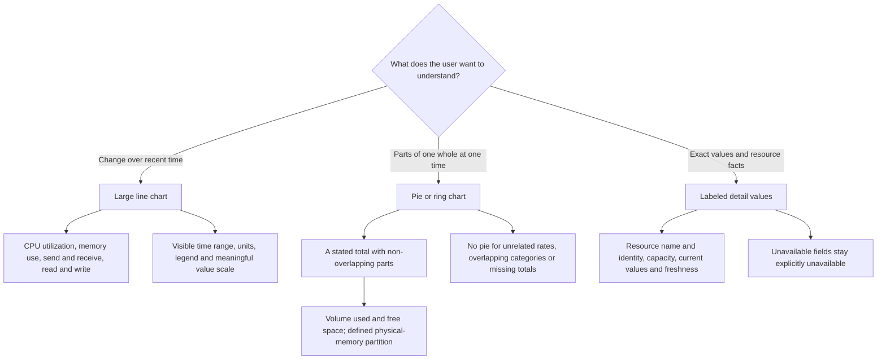
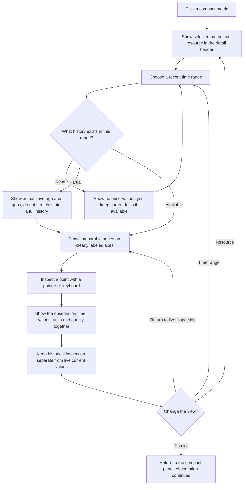
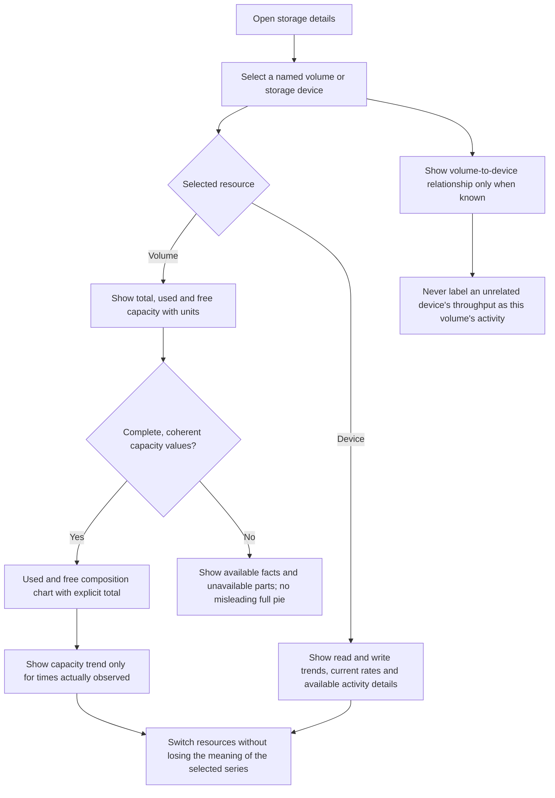
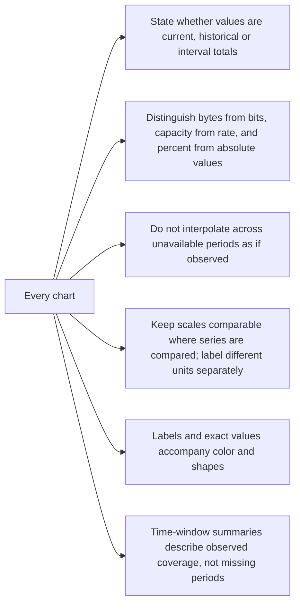

# 05 — Charts and Detailed Inspection

[Catalog](README.md) · [Next: settings](06-settings.md)

## Selecting the Right View

The detail view is an inspection surface rather than an enlarged copy of the panel. Its hierarchy is: selected resource and freshness, key current facts, a dominant recent-trend chart, then relevant composition and secondary details. A storage view therefore has room for capacity and resource identity, not just read/write numbers.

Line charts answer questions about change. Pie or ring charts answer part-to-whole questions at a clearly identified time. Exact figures remain visible beside both. The chart type follows the meaning of the data: network receive and send rates are not slices of a fixed whole, and overlapping memory categories must not be added into a misleading pie. A temporal average must not be labeled as the current composition.

The chart scope is limited to bounded lines, composition bars and rings, which favors native UI drawing over introducing a general charting platform. The acceptance criteria are readable rendering, accessible pointer/keyboard exact-value inspection and controlled drawing cost. This deliberately small chart scope avoids a dependency chosen from screenshots alone; revisit the choice only if measured implementation evidence fails those criteria. Default composition is a bar, with an explicit Bar/Ring preference for memory and storage.

## Detail Content and Information Budget

The inspection hierarchy borrows the useful organization of Task Manager's Performance view: a resource navigator, a selected trend, prominent current readings, and resource-specific facts. This is an information-architecture reference, not a reproduction of Task Manager or a claim to implement all its counters. The panel stays a glance surface; the additional content belongs in temporary inspection.

**Resource content:** core fields define the intended resource experience; secondary fields are shown when their source and meaning can be established. Unsupported fields carry an explanation, not a fabricated zero. Specifications do not promise universal hardware access. Optional facts should not displace the main chart or turn every unavailable sensor into a large empty card.

| Domain | Primary chart and current readings | Supporting facts | Scope and caveats |
| --- | --- | --- | --- |
| CPU | Total utilization; selectable logical-processor history; reported frequency | Processor model, sockets, physical cores, logical processors, base frequency; process/thread/handle counts and uptime; virtualization and cache facts if available | Counts describe the system, not a process manager. A frequency is reported, not an invented average across heterogeneous cores. Temperature collection is excluded from the initial version. |
| Memory | Physical in-use trend against usable total; in-use/available composition; exact current values | Installed and usable totals, hardware-reserved capacity, committed/limit, cache, compression, paged/non-paged pools; transfer rate, slots and form factor when known | Compression is a subset of in-use. Cache and pools overlap other accounting; they are not extra pie slices. Commit is not physical usage. |
| Network | Receive/send on a common rate axis; current rates and session totals with start time | Selected adapter identity/model, link state/type and reported link speed; optional address reveal | Link speed is not current throughput or guaranteed Internet speed. Totals state observed coverage and resets. Addresses are hidden by default. Physical and virtual adapters are not silently summed. |
| Storage | Volume used/free/total; named device active-time and read/write charts; current rates and response time | Known volume/device mapping, filesystem, device type/model; system/page-file status and capacity snapshot time where available | Busy percentage and response time are source-defined device measures. Capacity belongs to a volume. SMART, health, temperature and remaining-life collection are excluded from the initial version. |

The wide layout fits a resource rail, a substantial trend, four to six headline values, and two compact groups of facts without leaving a third of the window empty. Long names wrap or expose their full value through accessible inspection rather than collide with neighboring fields. A logical-processor view may use small multiples; a narrow detail view scrolls that section instead of squeezing twelve unreadable charts into one row.

Example memory accounting uses 32.0 GiB installed, 0.2 GiB hardware reserved, 31.8 GiB usable, 15.4 GiB in use and 16.4 GiB available. The displayed 48.4% uses the usable denominator. Example storage uses decimal units: 621 GB used + 379 GB free = 1 TB total. These are explanatory sample values, not measured hardware facts.

## Inspecting a Recent Time Window

The selected range represents an actual time interval, not a requested number of evenly spaced points. New application sessions may have only a small part of that interval available; the view must show that coverage honestly. Gaps stay visible. Longer ranges may use a reduced visual representation, but it must preserve meaningful variation and must not imply observations where none exist.

The live view follows recent observations. Inspecting a point reveals its timestamp, unit, value and quality, using the pointer or keyboard. Current headline values remain explicitly current; an inspected historical point does not silently relabel them. Resource selection updates the header and all affected series together. Changing a chart range does not change the collection cadence or start a new history.

## Storage Detail Journey

For a volume, show its identity and total, used and free capacity. A coherent used/free ring can accompany those values. For a storage device, show observed read/write trends and other available activity details. Present filesystem, device or volume facts only where available, without claiming that every storage arrangement has a simple one-volume-to-one-device mapping.

The user should be able to tell whether they are inspecting capacity, activity, or a known relationship between them. Capacity history is useful only over observed periods; it is not reconstructed from the current snapshot. If a resource is removed while its details are open, keep the selected identity visible and explain the unavailable live data rather than switching to an unrelated resource.

## Chart Honesty and Readability

Chart rendering is a consumer of observations, not their owner. Reopening or resizing a chart does not reset history. Keep drawing proportional to visible detail: a closed view does no chart drawing, and a long retained interval does not require every sample to become an independent visual element. Validate readability and runtime cost together rather than choosing a chart library from screenshots alone.

Units, labels and coverage are mandatory context. In particular, distinguish bits from bytes and decimal from binary capacity presentation. Choose consistent units through settings and apply them to the panel, detail facts, axes and inspection values together. Color reinforces meaning; it must not be the only way to identify a series or missing data.

