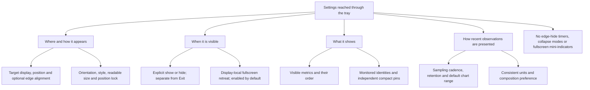
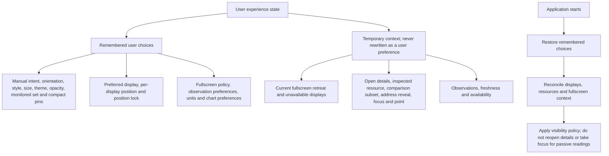
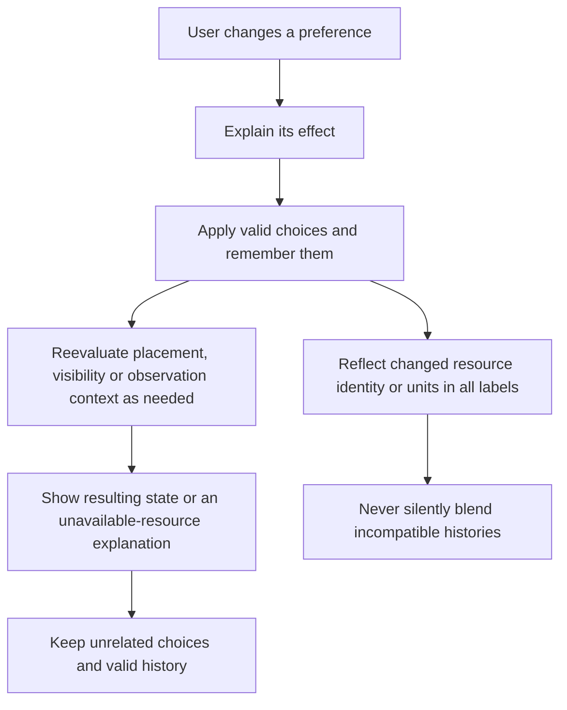
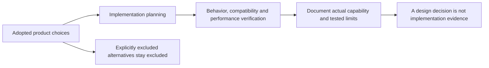

# 06 — Settings and Remembered State

[Catalog](README.md) · [Next: user journeys](07-user-journeys.md)

## Settings by User Intent

Settings are organized around user questions: where should the panel be, when should it appear, what should it show, and how much recent context should be available? They do not expose every internal threshold or sampling detail as a separate mode. The tray remains the route to settings while the panel is hidden.

The application has one coherent set of preferences. A tray visibility action updates the same manual intent that settings reflects. Observation and display preferences are separate: changing orientation does not reset history, and selecting a recent range does not change the underlying sampling interval.

## Appearance and Compatibility

Follow Windows light/dark appearance by default across the panel, details and settings; explicit Light and Dark overrides are included. Orientation, style and readable size are separate controls. Theme changes do not reset monitoring, visibility intent or placement.

Background opacity is an included optional adjustment, **80%–100% in 5% steps, initially 100%**, shared by the panel and details. Settings stay solid. Text, charts, focus indicators and input targets do not fade. Alpha, desktop blur and click-through are different behaviors; the initial product includes only plain background alpha. Blur materials, click-through and whole-window fading are excluded. Transparency disabled, high contrast, battery saver or unavailable support forces a readable solid background without erasing the saved preference. Settings explains the effective fallback.

The adopted compatibility floor is **Windows 10 21H2 build 19044, x64**. It is a product target, not a claim of vendor lifecycle support or completed compatibility testing. The current repository foundation still requires Windows 11 build 22000 or newer. This design commit changes no manifest, runtime or dependency. The [baseline evidence gates](08-design-baseline.md#compatibility-and-evidence-gates) must pass before changing shipped compatibility claims.

## Remembered Choices versus Temporary Context

Persist user choices across restarts, not incidental desktop state. Remembering hidden intent is different from remembering that fullscreen happened to be active when the application exited. A temporary fallback monitor does not replace the preferred display unless the user makes a new placement choice.

Preferences are application-local and per-user, with no cloud synchronization or export platform. Saving preferences must preserve unrelated choices and avoid a partially written configuration. Unreadable or unavailable choices produce a reachable application with clear feedback, not elevated operation or silent erasure of all valid preferences. The concrete storage format and migration mechanism are implementation decisions, not unresolved product behavior.

## Changing a Setting

Apply ordinary reversible settings directly, without restarting. Configuration of an unavailable resource retains the choice and explains its status instead of selecting a different device. Inspection and comparison remain temporary; neither action edits the monitored set or compact pins.

History-affecting changes have visible consequences. Extending retention cannot recover discarded samples; shortening it may remove old observations. Changing units preserves measurements and changes presentation. Changing resources changes identity and scope, so histories cannot be silently joined. No generic configuration transaction framework is needed to express these behavior-specific rules.

## Review Decisions

**Closed on October 12, 2026 under the owner's authorization to finalize the design.** [Chapter 08](08-design-baseline.md) records all adopted defaults, exact ranges, resource limits, excluded alternatives and acceptance targets. This is a decision record, not a remaining approval queue.

| Topic | Adopted baseline |
| --- | --- |
| Surfaces | One movable panel, one contextual detail window, one explicitly opened settings window. No duplicate panels or pinned dashboards. |
| First run | Shown, horizontal Balanced at 100%, top-center of primary usable area with a 12-logical-pixel inset, unlocked. |
| Size | Three styles in both orientations; 100%–200% adjustment; measured content and text scale can increase the minimum. |
| Resource scope | Concurrent monitored set, independent compact pins, separate inspection, comparisons of at most three resources. |
| Appearance | Follow system; Light/Dark overrides; 80%–100% background-only opacity, default solid; no blur or click-through. |
| Compatibility | Windows 10 21H2 build 19044+ x64 target; existing foundation remains Windows 11 until matching evidence permits a change. |
| Observation | One-second default dynamic sampling, ten-second capacity refresh, sixty-second slow facts. |
| History | Session-only, default one hour, bounded by 64 MiB observation payload; 1/5/15/60-minute chart ranges, initially five. |
| Details | Reuse one view; dismiss on Escape, close, outside interaction, settings, hide, retreat or a completed panel move. |
| Restart | Restore preferences, not observations, address reveals or open details. |
| Acceptance | Named OS, application, display, data-quality and performance scenarios in chapter 08; no invented passes. |

