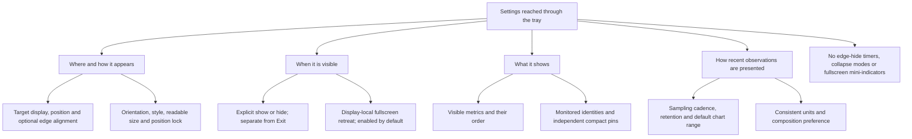
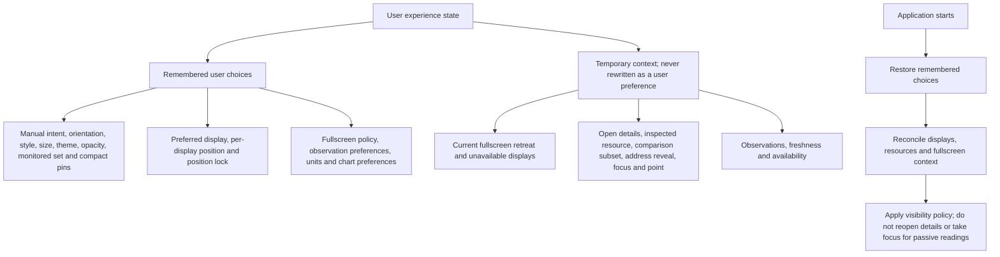
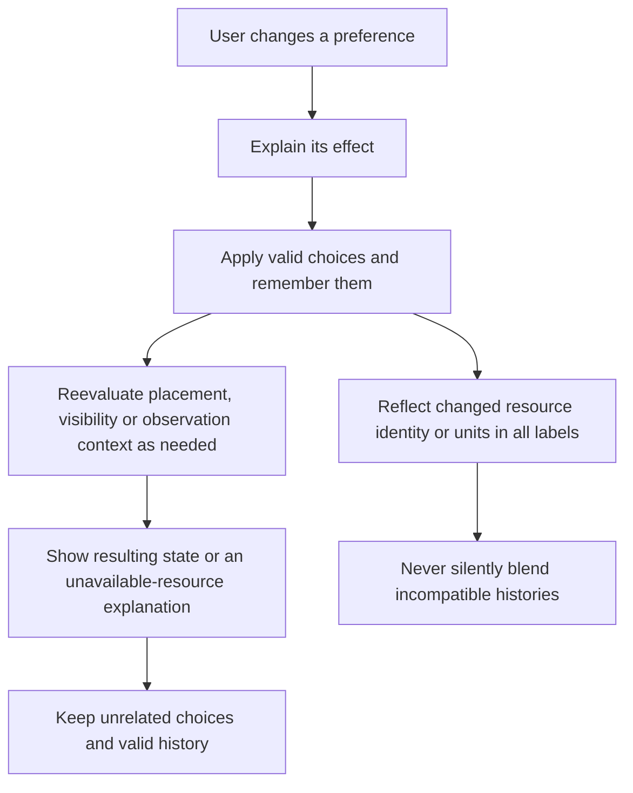
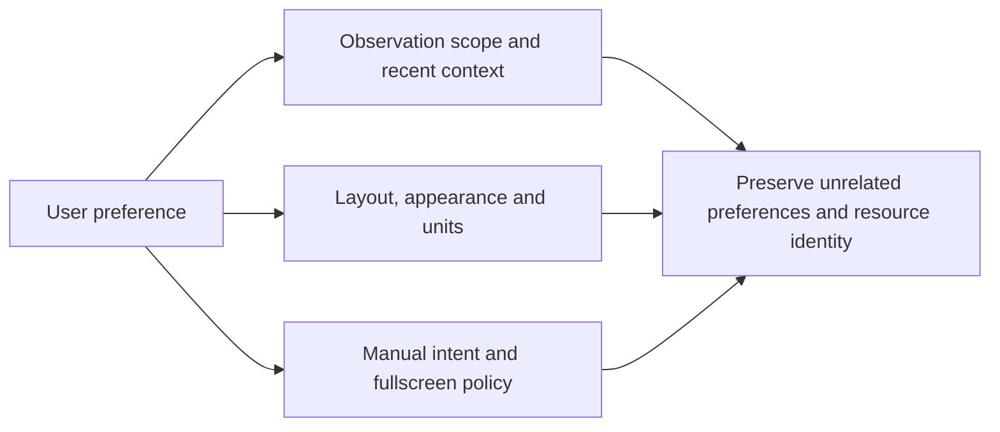

# 06 — Settings and Remembered State

[Catalog](README.md) · [Next: user journeys](07-user-journeys.md)

## Settings by User Intent

Settings are organized around user questions: where should the panel be, when should it appear, what should it show, and how much recent context should be available? They do not expose every internal threshold or sampling detail as a separate mode. The tray remains the route to settings while the panel is hidden.

The application has one coherent set of preferences. A tray visibility action updates the same manual intent that settings reflects. Observation and display preferences are separate: changing orientation does not reset history, and selecting a recent range does not change the underlying sampling interval.

## Appearance and Compatibility

Follow Windows light/dark appearance by default across the panel, details and settings; explicit Light and Dark overrides are included. Orientation, style and readable size are separate controls. Theme changes do not reset monitoring, visibility intent or placement.

Background opacity is an optional adjustment shared by the panel and details, with an opaque default. Settings stay solid. Text, charts, focus indicators and input targets do not fade. Alpha, desktop blur and click-through are different behaviors; the initial product includes only plain background alpha. Blur materials, click-through and whole-window fading are excluded. Transparency disabled, high contrast, battery saver or unavailable support forces a readable solid background without erasing the saved preference. Settings explains the effective fallback.

The design targets Windows 10 and newer. Appearance should degrade through readable fallbacks rather than make basic monitoring depend on optional platform effects. Actual supported builds and runtime requirements are operational facts documented in the project README, separate from this conceptual design.

## Remembered Choices versus Temporary Context

Persist user choices across restarts, not incidental desktop state. Remembering hidden intent is different from remembering that fullscreen happened to be active when the application exited. A temporary fallback monitor does not replace the preferred display unless the user makes a new placement choice.

Preferences are application-local and per-user, with no cloud synchronization or export platform. Saving preferences must preserve unrelated choices and avoid a partially written configuration. Unreadable or unavailable choices produce a reachable application with clear feedback, not elevated operation or silent erasure of all valid preferences. Storage format and migration mechanisms are outside this high-level design.

## Changing a Setting

Apply ordinary reversible settings directly, without restarting. Configuration of an unavailable resource retains the choice and explains its status instead of selecting a different device. Inspection and comparison remain temporary; neither action edits the monitored set or compact pins.

History-affecting changes have visible consequences. Extending retention cannot recover discarded samples; shortening it may remove old observations. Changing units preserves measurements and changes presentation. Changing resources changes identity and scope, so histories cannot be silently joined. No generic configuration transaction framework is needed to express these behavior-specific rules.

## Settings Boundaries

A setting should express a user-visible choice, not an internal mechanism. The useful distinction is between preferences that affect observation, presentation and visibility. Making these effects clear avoids unnecessary mode combinations and prevents one setting from resetting unrelated state.

Defaults provide a coherent starting experience: a visible compact panel, system-following appearance and useful built-in resource summaries. They do not create a second monitoring model. Fine-grained control ranges and initial numeric values belong to detailed design rather than this responsibility model.

