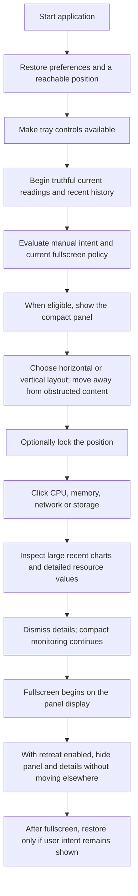
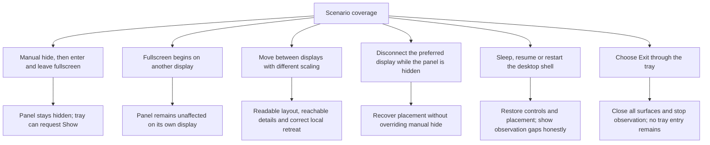
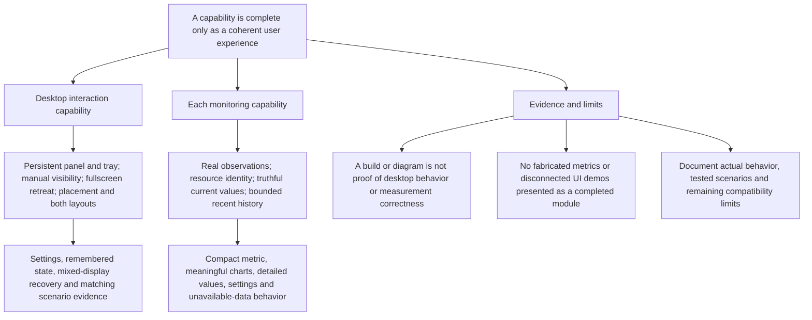
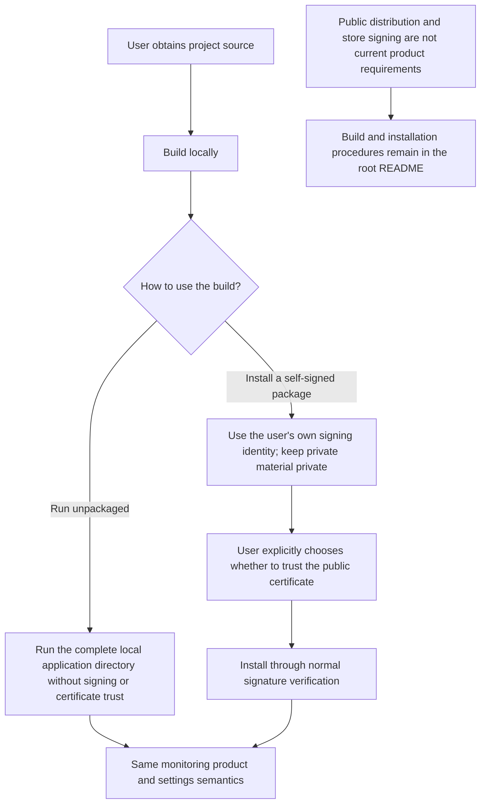

# 07 — End-to-End Journeys and Completion Boundaries

[Catalog](README.md) · [Next: adopted design baseline](08-design-baseline.md)

## Daily Observation

The primary path connects all earlier responsibilities: restore intent, establish current desktop context, collect observations, present the compact view, and inspect a selected resource. This is an end-to-end behavior description, not an implementation sequence or a claim of completed features.

A normal user should not need to understand which component collects a metric or places a window. They should know where the panel is, why it may be hidden, what a value means, and how to inspect it. Those are the acceptance boundaries for the adopted architecture.

## Visibility, Recovery and Exit Scenarios

Use scenarios that exercise competing intentions and desktop changes, not just isolated happy paths. Each scenario must preserve the distinction between preferred placement and temporary fallback, and between user hiding and fullscreen retreat. Test both horizontal and vertical layouts and details opened near each edge.

| Area | Evidence needed before declaring the capability complete |
| --- | --- |
| Visibility | Manual hide/show before, during and after fullscreen; ordinary maximized windows; fullscreen on another display. |
| Displays | Mixed scaling, display reordering, disconnect/reconnect, taskbar bounds, and movement across shared edges. |
| Detail interaction | Keyboard and pointer inspection, dismissal, resource changes, and hide/retreat while details are open. |
| Observation semantics | Known inputs for rates and totals, counter resets, resource changes, valid zero, stale values and missing intervals. |
| History and charts | Partial coverage, retention boundaries, consistent units, capacity composition and gaps under reduced chart detail. |
| Lifecycle and cost | Sleep/resume, shell restart, clean exit, responsive interaction, bounded history and no drawing for closed details. |

These are required evidence categories. [Chapter 08](08-design-baseline.md#compatibility-and-evidence-gates) fixes the desktop/application matrix and performance budgets. Record exact tested versions, hardware and results when executing those gates; the design does not substitute for them.

## Second-Round Review Scenarios

These acceptance scenarios are adopted requirements; the static images do not prove them implemented.

| Scenario | Expected result |
| --- | --- |
| Monitor C:, D: and E:, pin C: used capacity, inspect D: | All three histories continue. The panel still shows C:; no extra permanent tiles appear. |
| Compare two devices, then return to one volume | Shared-scale comparison does not change collection or join volume/device totals. |
| Unplug a pinned external drive | The same identity becomes disconnected with its last-observed time. No silent fallback to C: or a same-letter replacement. |
| Stop monitoring an inspected or pinned drive | New samples stop with an explicit boundary; old observations expire normally. Replacement remains an explicit user action. |
| Switch CPU total/logical view or resize details | Existing history remains; narrower layouts reflow/scroll without changing collection cadence. |
| Inspect a historical network point across a gap | The point shows time, direction, units and quality. Current values stay current; missing intervals are not zero. |
| Compare memory headline, composition and facts | In-use + available equals usable total; reserved memory explains the installed difference. Cache/compression are not counted twice. |
| Change Windows theme or disable transparency | Panel, details and settings remain consistent and readable. Foreground data does not fade with the background. |
| Use a small desktop at increased text scale | Essential labels and close/navigation controls remain usable; no uniform shrink-to-fit or edge-hide workaround. |
| Validate the Windows 10 product target | Target Windows 10 21H2 build 19044+ x64, using chapter 08's test matrix. Validate packaging, runtime and solid fallback before changing compatibility claims; the current Windows 11 foundation is not evidence. |

## Complete Capability Deliveries

Delivery follows complete capability boundaries, not a series of disposable demos. The desktop interaction capability includes its visibility state, placement, tray access, both layouts, settings and recovery behavior. Each monitoring capability includes real observations, truthful quality states, compact presentation, history, meaningful details and verification.

The boundaries are not an instruction to invent a framework first or divide implementation across parallel owners. Shared behavior should have one owner because the product needs consistent state, not because every diagram box must become an abstraction. A monitoring capability is not complete when it can display a fabricated number or an isolated chart.

## Source Build and Optional Trusted Installation

Both source-built unpackaged use and explicitly trusted self-signed installation remain supported product paths. Their monitoring behavior is the same. Building a package, trusting a certificate and installing it are separate user decisions; no trust operation is hidden in routine application startup. Detailed commands belong in the root README rather than in the architecture specification.

Public distribution is not the current objective. The existing build/test/release foundation is not evidence that these adopted monitoring and desktop behaviors already work.

