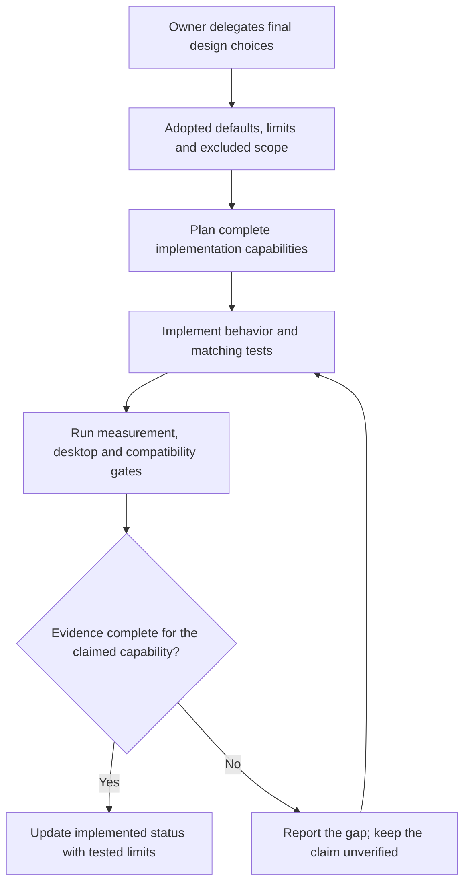

# 08 — Adopted Design Baseline

[Catalog](README.md) · [Previous: acceptance journeys](07-user-journeys.md)

## Decision Status

On October 12, 2026, the project owner authorized finalizing the remaining design choices and publishing the specification before implementation planning. The decisions below were selected under that delegation. They are the **adopted initial-product contract**, not claims that features, compatibility or performance have already been delivered. No remaining product decision blocks implementation planning.

Chapters 00–07 explain behavior and rationale. This chapter owns exact defaults, supported scope and acceptance targets; the static boards illustrate them rather than override them. Future changes need an explicit recorded decision, not silent expansion during implementation. Implementation mechanisms such as classes, APIs, file schemas and individual dependency versions belong to implementation planning, not an unresolved product backlog.

## Desktop and Interaction

| Topic | Adopted decision | Reason / boundary |
| --- | --- | --- |
| Application shape | One per-user desktop application, one movable panel, one reusable detail window and one settings window | No service, elevation helper, web runtime or plugin host. A second launch activates the existing control path rather than duplicating collectors. |
| Visibility | Initially shown; manual intent persists; fullscreen retreat enabled on the panel display | No edge auto-hide, collapse, wake zone or miniature fullscreen indicator. Explicit Show does not bypass enabled retreat. |
| Window behavior | Floating above ordinary windows, without activation for periodic readings; no reserved desktop strip | No guarantee of drawing above exclusive-fullscreen content or secure desktop. Settings are explicit user interaction and never force the panel shown. |
| First-run placement | Primary display, top-center of usable area, 12 logical pixels inward; unlocked | Deterministic and easy to move. Respect taskbar bounds and preserve per-display placement. |
| Orientation and style | Horizontal, Balanced by default; Minimal and Capsules are equally supported styles in both orientations | Styles change presentation, not monitoring. Moving to another edge does not change orientation. |
| Details | One reusable window; default 1,000 × 680 logical pixels, minimum 400 × 480 subject to text scale | Resource rail at widths of at least 800; chooser plus scrolling below that. Fit to usable display bounds without shrinking text. |
| Dismissal | Escape, explicit close, outside activation/click, settings opening, manual hide, fullscreen retreat or completed panel move | Pointer departure alone does nothing. Child menus and chart interactions count as inside. Never restore dismissed details automatically. |
| Tray | Status, explicit Show/Hide, Settings, Lock position and Exit | Hiding does not stop collection. Recreate the tray after Explorer restarts without changing intent. |
| Startup | Manual launch by default; no automatic sign-in startup in the initial scope | No hidden startup registration. |
| Multiple displays | One panel moves between displays; unavailable preferred display uses a reachable temporary fallback | Simultaneous duplicate panels are excluded. Returning displays restore preference unless a newer user move superseded it. |

### Sizing Contract

The following four-metric layouts define the base sizes at 100% application size and normal Windows text scale. These are product targets to validate, not measured native limits.

| Style | Horizontal base | Vertical base |
| --- | --- | --- |
| Minimal | 432 × 32 logical pixels | 116 × 152 logical pixels |
| Balanced | 528 × 48 logical pixels | 144 × 280 logical pixels |
| Capsules | 528 × 40 logical pixels | 144 × 220 logical pixels |

Application size is adjustable from **100% to 200% in 10% steps**, initially 100%. The base size is the requested floor for four visible metrics; measuring actual content and system text scale can require a larger minimum. Never shrink below readable content to meet a numeric target. Fewer visible metrics may reduce the unused dimension, but each metric keeps its minimum interaction area. Reserve at least a 32 × 32 logical-pixel target per compact metric. Native labels use at least 11 logical pixels and values at least 12 before system text scaling; magnified static boards are not typography measurements.

First remove optional sparklines and surplus spacing when constrained, while retaining the selected style's grouping. If essential content still cannot fit, offer explicit fewer-metric or orientation choices. Do not automatically cycle metrics, change style, hide units or collapse the panel. Settings remain reachable through the tray. The acceptance floor is an 800 × 600 logical-pixel usable desktop; unusually smaller areas must still expose recovery controls but are not a full-layout guarantee.

## Appearance and Materials

- Follow Windows light/dark appearance by default. Explicit Light and Dark overrides are included. Use neutral surfaces with a blue primary accent; distinguish second chart series by labels and line pattern as well as color. High contrast overrides decorative colors.
- Panel and detail background opacity: **80%–100% in 5% steps, default 100%**, shared preference. Settings remain solid. Opacity never fades text, charts, focus indicators or hit targets.
- Initial scope uses a plain background with alpha, not Acrylic, Mica or a custom blur stack. Blur, click-through, full-window fading, wallpaper-aware color extraction and theme packs are excluded. This avoids making basic readability depend on a platform-specific material.
- Transparency disabled, high contrast, battery saver or unavailable alpha support forces an opaque readable background while retaining the user's saved preference. Display an effective-state explanation in settings. Unsupported transparency must not prevent ordinary monitoring.

## Resources and Initial Selections

| Choice | Adopted behavior |
| --- | --- |
| Compact order | CPU utilization, physical memory in use, network receive rate, system-volume used capacity. Four slots initially visible; user may hide/reorder them. |
| CPU / memory | Always collected while running; total CPU and physical in-use are the default views. Logical CPU charts and memory accounting are details, not extra panel tiles. |
| Initial storage set | Mounted local fixed volumes with usable capacity, plus their distinct known physical devices. Exclude network shares, optical media and unmounted partitions. Select up to 32 volumes and 32 devices, system resource first then stable identity order; disclose any excess instead of silently rotating. |
| Initial network set | At most 16 non-loopback identities: include the active default-route adapter first, even if virtual, then connected physical adapters, then other physical adapters in stable identity order. The route adapter is therefore inside the monitored limit and is the initial compact pin; label virtual identity explicitly. If no route exists, pin the first selected connected physical adapter, then the first selected physical adapter; otherwise show unavailable. |
| New devices after setup | Discover and offer for explicit monitoring; do not silently alter the saved set. Previously selected identities resume on reconnection with a visible gap. |
| Removable / virtual resources | Removable storage and additional virtual/tunnel adapters are explicit opt-ins, within the same limits. No implicit physical-plus-virtual traffic sum. |
| Compact pins | One resource and one metric per domain slot. Pin the system volume's used capacity and the initially selected adapter's receive rate. Neither inspection nor route changes automatically repin. |
| Inspection / comparison | Independent temporary selections. Compare up to three named devices/adapters using same-unit, same-time, shared-scale small multiples. No aggregate busy percentage or overlapping volume/device total. |
| Resource removal | Stop new collection, retain identified observations until expiration, and show Not monitored if still pinned or inspected. Explicitly repin or re-enable; never silently substitute. |
| Missing identity | Preserve the unavailable selection. A reused name, drive letter or adapter label is not sufficient to join histories. |

Resource limits bound an ordinary desktop product, not a fleet-monitoring platform. Reaching a limit produces an explicit choice; it never stops an unrelated selected resource. Storage identity, volume/device mappings and resource-scoped failure behavior are acceptance requirements.

## Observation, History and Presentation

| Topic | Adopted decision |
| --- | --- |
| Dynamic sampling | Default 1 second; settings offer 1, 2 and 5 seconds. CPU, memory use, adapter traffic and device activity share collection where appropriate. Rates use actual elapsed time. |
| Slow facts | Capacity refresh every 10 seconds; hardware/resource facts on discovery and every 60 seconds. Reconnection refreshes affected facts. Show actual observation time. |
| Staleness | Mark a time-varying reading stale after three of its expected sample intervals without a valid observation; keep last-observed time. Known disconnection/failure can be reported immediately. Unsupported facts are not zero. |
| Retention | Session-only in-memory history, default 60 minutes; choices 15, 30 and 60 minutes. No persistence, telemetry, upload or archive database. |
| Chart range | Presets 1, 5, 15 and 60 minutes, initially 5. A requested range longer than coverage remains partial; never synthesize old samples. |
| Memory budget | Retained observation payload is capped at 64 MiB across resources. Under pressure, expire the oldest time band consistently and disclose shortened coverage; never invent a longer retained interval. |
| Visibility / cost | Hidden panel and closed details keep sampling; closed charts do not draw. Visible current values follow the sampling cadence, not a high-frequency animation loop. |
| Units | Memory uses binary GiB/MiB; storage capacity and traffic default to decimal GB/MB and MB/s. Offer decimal/binary presentation per domain and bits/bytes for network rate; use one consistent setting per domain across all surfaces. Link capacity remains explicitly bit/s. |
| Counts / clocks | Session traffic totals state their start and observed coverage. Counter reset starts a marked counting segment. Labels use local time; elapsed intervals must remain truthful across wall-clock changes. |
| Chart semantics | CPU and busy time use 0–100%; physical memory uses 0–usable capacity. Rates start at zero and use a labeled ceiling derived from the selected observed window. Compared charts share a ceiling; missing intervals break all affected lines. |
| Composition | Default to compact bars for memory and storage. A Bar/Ring preference is available for those same non-overlapping parts; no pie for rates, commit or cache. |
| Chart technology direction | Use the existing native UI drawing facilities for bounded lines, bars and rings; no additional chart package in the initial baseline. Keep pointer/keyboard exact-value inspection and textual summaries as first-class content. Revisit only with measured evidence that the native approach fails acceptance. |
| Privacy | Address reveal is explicit and temporary; hide again after detail dismissal. No remote access, automatic export or background telemetry. |

CPU topology and system counts, memory accounting and configuration, adapter link information, and storage activity/capacity belong in the detailed field inventory in chapter 05. A source that does not expose a field produces a precise unavailable reason. This is not permission to omit a core metric silently. Hardware temperature, SMART, remaining life and third-party sensor integrations are **excluded from initial collection**; their location in illustrative boards may state Not collected in the initial version. Do not add a driver or elevate the whole application to fill an optional card.

## Compatibility and Evidence Gates

The compatibility target is **Windows 10 21H2, build 19044 or newer, x64**. Windows 10 22H2 and Windows 11 are included in that target; earlier builds, native ARM64/x86 packages and Windows Server are outside the initial acceptance scope. This is an application compatibility floor, not a claim that every Windows edition remains under Microsoft or .NET servicing support.

The current repository still targets a minimum of Windows 11 build 22000. No source, manifest or dependency change is made by finalizing this specification. Lowering the shipped minimum requires real build/package/runtime evidence on the target versions, including the exact selected Windows App SDK runtime. A framework overview or this decision table is not that evidence.

The official .NET 10 supported-OS table was checked on October 12, 2026. It distinguishes Windows 10 Enterprise/IoT 21H2 from other editions and ties support to the OS lifecycle. Use Windows 10 Enterprise LTSC 2021 as the maintained Windows 10 validation baseline; include 22H2 as a separate compatibility case rather than assume vendor servicing from its build number. Reference: `https://raw.githubusercontent.com/dotnet/core/main/release-notes/10.0/supported-os.md`.

| Evidence gate | Required scenarios / criterion |
| --- | --- |
| OS and packaging | Windows 10 Enterprise LTSC 2021 (19044), Windows 10 22H2 (19045), Windows 11 24H2 and 25H2; source-built unpackaged use on each, self-signed install only in disposable trusted test environments. Record exact OS edition/build/runtime. |
| Displays and text | Single 1920 × 1080 at 100%; mixed 100%/150% and 100%/200% displays; portrait display; 200% Windows text scaling; 800 × 600 logical usable bounds; each edge, taskbar changes and disconnect/reconnect. |
| Fullscreen applications | Microsoft Edge F11 and fullscreen video, VLC video, LibreOffice Impress slideshow, and SuperTuxKart fullscreen. Test ordinary maximized and borderless states separately. Record application versions and actual presentation modes. |
| Exclusive fullscreen | A controlled DXGI exclusive-fullscreen test application on a real interactive GPU session; actual exclusive mode must be observed, not inferred from a game setting. No general overlay guarantee. |
| Visibility ordering | Manual hide/show before, during and after fullscreen on either display; retreat/return within 500 ms after desktop context settles; no oscillation during a one-second stable state. Never reopen dismissed details or steal focus. |
| Resource correctness | Real measurements and deterministic reference inputs; valid zero, counter resets, gaps, drive unplug/reuse, multiple drives and adapters, scope mapping, long names, non-Latin labels and denied/unsupported fields. |
| Performance target | On a recorded x64 reference machine with at least 4 logical CPUs and 16 GiB RAM: after warm-up, a 10-minute default-cadence idle run with 4 volumes, 2 devices and 2 adapters averages at most 1% total-machine CPU and uses at most 200 MiB private bytes; opening populated details p95 at most 200 ms. These are acceptance budgets, not existing measurements. |
| Lifecycle | Two-hour monitoring/retention soak, near-limit resource sets, sleep/resume, Explorer restart, clean exit, interrupted preference writes and second launch. Collection stays bounded and preferences retain unrelated choices. |

A missing test environment is an explicit delivery blocker for that compatibility claim, not a reason to report a pass. Record failures and revise the implementation; changing an adopted product target requires a separate decision. Desktop coverage cannot be replaced by a successful build or by CI on a single Windows version.

## Closed Alternatives and Next Boundary

The initial scope excludes multiple simultaneous panels, pinned detail dashboards, durable history, automatic metric rotation, blur materials, click-through, advanced sensors, process control, auto-start registration, telemetry, plugins and cloud services. These are decisions, not lingering questions to implement opportunistically.

The specification is ready for implementation planning. That next phase will order complete capabilities and their verification; it will not restart product discovery or claim that this design commit implements them.

