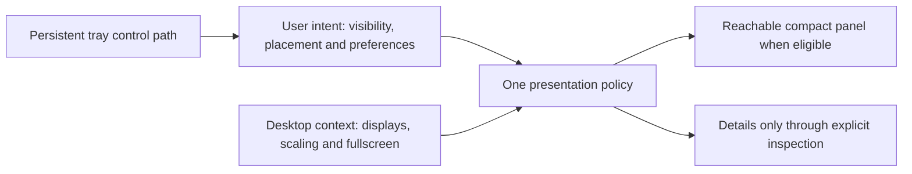

# 08 — Design Principles and Boundaries

[Catalog](README.md) · [Previous: user journeys](07-user-journeys.md)

## A Coherent Desktop Experience

MyFinder is a compact monitoring application, not a desktop shell or a permanently expanded dashboard. A single movable panel provides continuous awareness; a reusable detail view provides intentional inspection. The tray remains a stable control path when neither surface is visible.

This separation keeps the desktop footprint small without making the information shallow. Orientation, visual style and size affect presentation, not which resources are collected. Adding monitored drives must not create more permanent windows or widen the panel automatically.

## User Intent and Temporary Context

Explicit user choices and temporary desktop conditions have different lifetimes. Manual visibility, preferred placement and resource selections express intent. Fullscreen activity, display availability, focus and an open detail view describe the current situation.

Presentation is derived from both, rather than maintained through competing hide/show commands. Manual hiding wins over automatic recovery. Fullscreen retreat is local to the panel's display and never rewrites the visibility preference. Returning to ordinary work restores only eligible surfaces, without reopening dismissed details or taking focus.

## Collection Is Independent of Inspection

The monitored set owns collection. Compact pins choose a small set of summaries, while inspection and comparison choose what to examine in detail. These selections consume the same resource-scoped observations; they do not create separate monitoring sessions.

Resource identity is more durable than its displayed name, drive letter or position in a list. Disconnection leaves an identifiable gap, not a zero reading or an opportunity to substitute a different device. Removing a resource from monitoring stops new observations without changing unrelated selections. Existing history remains associated with its original resource until it expires.

Volume capacity and device activity answer different questions. Network link capacity and observed traffic are similarly distinct. Relationships are shown only when known; overlapping resources are not silently summed. Named per-resource views and comparable small multiples are preferred to an ambiguous machine-wide total.

## Truthful Information with Bounded Cost

Collection, recent-history retention and drawing have separate responsibilities. Closing details avoids unnecessary drawing but does not erase history or stop monitoring. Recent observations are session-local and bounded; the application is not an archival monitoring database.

History describes what was actually observed. Missing periods remain gaps, stale readings retain their last-observed context, and unsupported fields carry an explanation. Rates use elapsed observation intervals; interval totals state their scope and coverage. Extending a chart range cannot reconstruct data that was never collected or has already expired.

The compact panel prioritizes current values and essential identity. Details add trends, composition and resource facts. Chart form follows meaning: lines show change, bars or rings show non-overlapping parts of a stated whole, and exact values accompany visual summaries. Native drawing is preferred for this limited chart scope; a general charting platform is not a product requirement.

## Readable, Adaptable Surfaces

A usable minimum size is defined by content, text scaling and interaction, not by shrinking every element into a fixed rectangle. Optional sparklines and surplus spacing yield before values, units and resource identity. Details resize independently and reflow or scroll when space is constrained.

System-following light/dark appearance keeps the panel, details and settings coherent. Background opacity is independent of foreground legibility and input behavior. A solid fallback preserves usability when transparency is disabled or unavailable. Plain background alpha does not imply blur, click-through or whole-window fading.

The design targets Windows 10 and newer without making basic monitoring depend on optional visual effects. Compatibility includes window behavior, packaging, data sources and fallbacks, not merely the framework's platform range. Actual supported environments and operational requirements belong in the project README and are backed by implementation evidence.

## Scope and Tradeoffs

| Design choice | Benefit | Deliberate boundary |
| --- | --- | --- |
| One movable panel and one contextual detail view | Small persistent footprint with depth on demand | No duplicate panels or pinned chart dashboards. |
| Floating placement with display-local retreat | Preserves ordinary application layout and fullscreen work | No reserved desktop strip, automatic wandering or universal fullscreen overlay guarantee. |
| Shared, bounded session observations | Consistent values and useful recent context without archival infrastructure | No durable history, cloud monitoring or telemetry. |
| Explicit resource identities and selections | Predictable multi-resource inspection and honest failures | No silent repinning, automatic metric rotation or ambiguous aggregate totals. |
| Native user-session application | Direct integration without an extra application platform | No service, elevated helper, plugin host or embedded web runtime. |
| Readable solid fallback | Stable operation across themes and capabilities | No dependency on blur materials, click-through or advanced hardware sensors. |

CPU, memory, network and storage monitoring are read-only observations, not process control or system administration. Optional hardware facts must not require running the whole application as administrator. Source-built use and explicitly trusted installation share the same monitoring semantics; certificate trust remains a separate user action.

## Quality Boundaries

Correctness spans ordinary use and transitions: resource replacement, sleep, display changes, text scaling, shell restart and competing visibility actions. The behavior must remain understandable when data or a capability is missing. Recovery preserves intent rather than silently restoring a convenient but incorrect state.

This specification describes concepts, responsibilities and observable behavior. Exact control dimensions, polling options, resource ceilings, performance budgets, test environments and delivery order belong to detailed design and implementation planning. They do not replace the principles above, and implementation evidence is still required before claiming a capability works.
