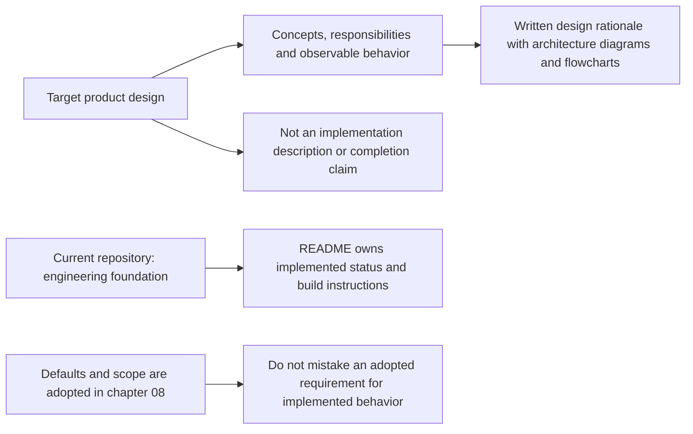
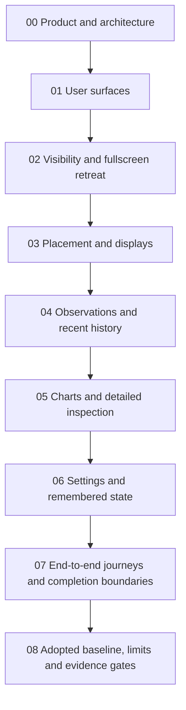

# MyFinder Design Specification

## Status and Scope

This is the **adopted high-level design baseline**, not an implementation manual. It explains the architecture, responsibility boundaries, behavior, rationale, and tradeoffs. Mermaid diagrams support that explanation; they do not replace it. Class structures, API signatures, storage schemas, and implementation recipes are deliberately out of scope.

The agreed product is a normally persistent, movable monitoring panel with horizontal and vertical layouts, tray controls, explicit hiding, and automatic fullscreen retreat. Clicking a metric opens a larger view of recent observations and detailed resource information, including storage capacity. Edge auto-hide and delayed collapse are no longer product requirements.

The repository currently contains only the engineering foundation. These specifications do not claim the monitoring product is implemented. Read [the project README](../README.md) for actual status and operational commands.

**Decision status:** on October 12, 2026, the owner authorized finalizing all remaining choices before implementation planning. [08 — Adopted design baseline](08-design-baseline.md) fixes defaults, size/opacity ranges, Windows compatibility target, observation limits, excluded scope and acceptance gates. There is no remaining product approval queue; unexecuted tests remain unexecuted tests, not undecided requirements.

## Reading Path

Start with the product and system boundaries, then follow the primary interaction, visibility and placement decisions. Read observation semantics before evaluating charts: a chart is only useful if resource identity, time, units and missing data are understood. The final chapters connect settings, acceptance journeys and exact adopted decisions to the same design.

## Chapter Catalog

- [00 — Product and architecture](00-overview.md)
- [01 — User surfaces](01-user-surfaces.md)
- [02 — Visibility and fullscreen retreat](02-visibility.md)
- [03 — Placement and displays](03-placement-and-displays.md)
- [04 — Observations and recent history](04-observations-and-history.md)
- [05 — Charts and detailed inspection](05-charts-and-details.md)
- [06 — Settings and remembered state](06-settings.md)
- [07 — End-to-end journeys and completion boundaries](07-user-journeys.md)
- [08 — Adopted design baseline](08-design-baseline.md)

## Visual Prototypes

The [visual prototype gallery](prototypes/README.md) contains seventeen numbered image boards and an overview. View the PNGs directly to compare panel layouts, large detail charts, settings and behavior. Editable SVGs accompany them. All readings are illustrative; these illustrate the adopted design, not completed application behavior.

Round two expands the CPU, memory, network and storage content, separates concurrent monitoring from compact pins and inspection, and adds footprint, theme, multi-drive and constrained-detail studies. Start with boards **04–07**, then **13–17**. Chapter 08 adopts the base sizes and background-alpha policy; native validation is still required. The Windows 10 21H2 build 19044+ x64 target is distinct from the current Windows 11 foundation.

## Next Boundary

Implementation planning follows this baseline. Plan complete capability deliveries with matching tests; do not restart framework selection, re-open settled scope by implication, or treat static sample data as real monitoring. Validate the compatibility and runtime-cost gates before making completion claims.

[Project status and commands](../README.md)
