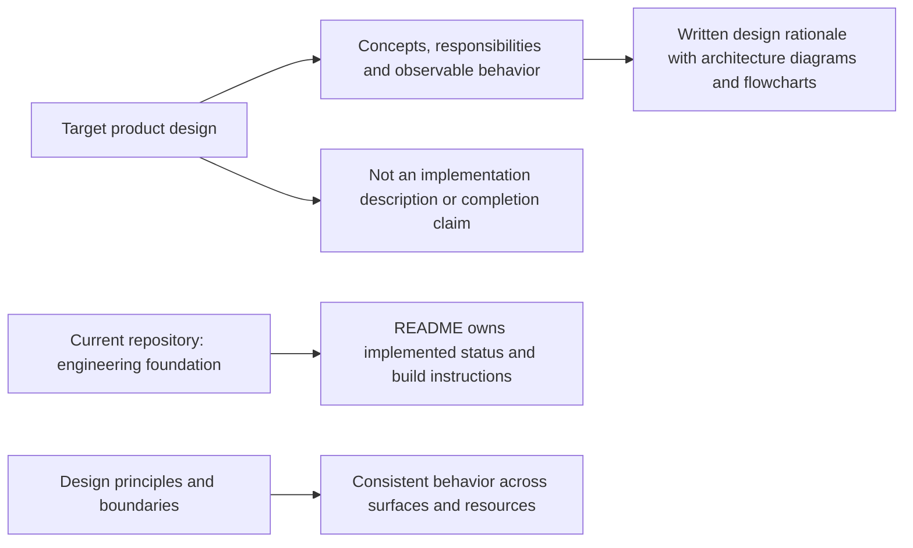
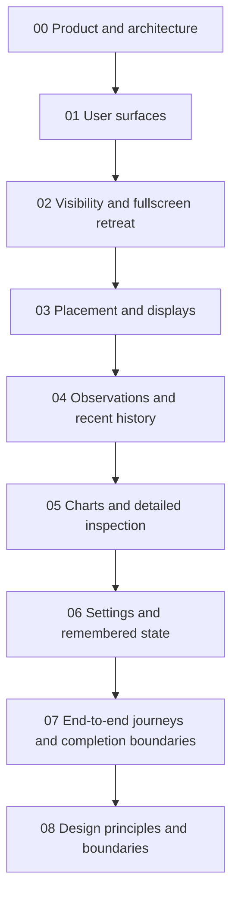

# MyFinder Design Specification

## Scope

This specification describes **high-level design concepts**, not an implementation manual or a decision log. It explains the architecture, responsibility boundaries, behavior, rationale, and tradeoffs. Mermaid diagrams support that explanation; they do not replace it. Class structures, API signatures, storage schemas, and implementation recipes are deliberately out of scope.

The agreed product is a normally persistent, movable monitoring panel with horizontal and vertical layouts, tray controls, explicit hiding, and automatic fullscreen retreat. Clicking a metric opens a larger view of recent observations and detailed resource information, including storage capacity. Edge auto-hide and delayed collapse are no longer product requirements.

The repository currently contains only the engineering foundation. These specifications do not claim the monitoring product is implemented. Read [the project README](../README.md) for actual status and operational commands.

[08 — Design principles and boundaries](08-design-baseline.md) connects the product's core concepts and tradeoffs. Dates, approval history, numeric tuning parameters and test execution records are outside this specification.

## Reading Path

Start with the product and system boundaries, then follow the primary interaction, visibility and placement decisions. Read observation semantics before evaluating charts: a chart is only useful if resource identity, time, units and missing data are understood. The final chapters connect settings, user journeys and cross-cutting design principles to the same design.

## Chapter Catalog

- [00 — Product and architecture](00-overview.md)
- [01 — User surfaces](01-user-surfaces.md)
- [02 — Visibility and fullscreen retreat](02-visibility.md)
- [03 — Placement and displays](03-placement-and-displays.md)
- [04 — Observations and recent history](04-observations-and-history.md)
- [05 — Charts and detailed inspection](05-charts-and-details.md)
- [06 — Settings and remembered state](06-settings.md)
- [07 — End-to-end journeys and completion boundaries](07-user-journeys.md)
- [08 — Design principles and boundaries](08-design-baseline.md)

## Visual Prototypes

The [visual prototype gallery](prototypes/README.md) contains seventeen numbered image boards and an overview. View the PNGs directly to compare panel layouts, large detail charts, settings and behavior. Editable SVGs accompany them. All readings are illustrative; these illustrate the design concepts, not completed application behavior.

The boards illustrate resource details, the separation of monitoring from compact pins and inspection, desktop footprint, theme, multi-drive views and constrained layouts. Start with **04–07**, then **13–17**. Example dimensions, control values and readings make the illustrations concrete; they are not a parameter contract.

## Design Boundary

The specification explains what the product means and how its responsibilities relate. Detailed design and implementation planning supply concrete sizing, timing, resource budgets and verification environments. Neither diagrams nor static sample data establish completed behavior.

[Project status and commands](../README.md)
